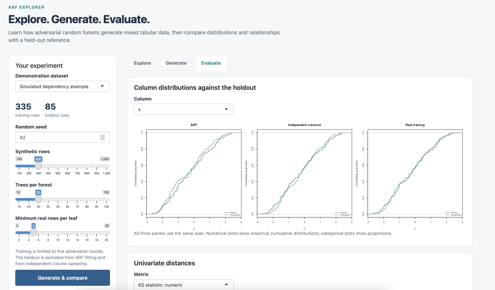

# arf: Adversarial random forests <a href='https://bips-hb.github.io/arf/'></a>

<!-- badges: start -->
[](https://cran.r-project.org/package=arf)
[](https://github.com/bips-hb/arf/actions/workflows/R-CMD-check.yaml)
[](https://app.codecov.io/gh/bips-hb/arf)
<!-- badges: end -->

> **Fork notice:** This repository is a personal extension of the
> official [arf](https://github.com/bips-hb/arf) package, featuring
> an experimental interactive Shiny application for synthetic data
> generation and evaluation. The badges above refer to the original
> upstream package.

## Introduction

Adversarial random forests (ARFs) recursively partition data into
fully factorized leaves, where features are jointly independent.
The procedure is iterative, with alternating rounds of generation
and discrimination. Data become increasingly realistic at each
round, until original and synthetic samples can no longer be
reliably distinguished. This is useful for several unsupervised
learning tasks, such as density estimation and data synthesis.
Methods for both are implemented in this package. ARFs naturally
handle unstructured data with mixed continuous and categorical
covariates. They inherit many of the benefits of RFs, including
speed, flexibility, and solid performance with default parameters.

## ARF Explorer — Interactive Shiny Application

This fork introduces **ARF Explorer**, an interactive Shiny
application for exploring synthetic tabular data generation and
statistical evaluation using adversarial random forests.

The application provides a graphical interface for understanding
ARF, experimenting with different model configurations, visualising
data distributions and dependencies, and evaluating the statistical
similarity between real and synthetic datasets.

### Application preview

<p align="center">
  
</p>

### Installation

Install this extended version of `arf` from GitHub:

```r
devtools::install_github("aswanijehangeer/arf")
```

Install the optional application dependencies:

```r
install.packages(c("shiny", "writexl"))
```

### Launch the application

The application can be launched directly from the R console:

```r
library(arf)

run_explorer()
```

Alternatively:

```r
arf::run_explorer()
```

The application provides an interactive environment for exploring,
generating, evaluating and exporting synthetic data without
requiring users to manually implement the complete workflow.

### Application workflow

The application is organised into three main stages:

#### 1. Explore

- Select a built-in example dataset.
- Inspect numerical and categorical variables.
- Explore marginal distributions.
- Visualise relationships between variables.
- Examine training and holdout data partitions.

#### 2. Generate

- Configure the number of synthetic observations.
- Set a random seed for reproducibility.
- Configure the number of trees.
- Adjust the minimum node size.
- Generate synthetic data using adversarial random forests.
- Generate an independent-column sampling baseline.
- Inspect adversarial classification accuracy across iterations.
- Preview and download generated synthetic data.

#### 3. Evaluate

- Compare real and synthetic marginal distributions.
- Inspect empirical cumulative distribution functions.
- Evaluate categorical probability distributions.
- Explore numerical dependencies through scatter plots.
- Compare Pearson correlation coefficients.
- Review quantitative evaluation metrics.
- Export complete experiment results.

### Available datasets

| Dataset | Description |
|---|---|
| Dependency dataset | Simulated mixed-type dataset with numerical and categorical dependencies. |
| Iris dataset | Fisher's classical iris dataset containing numerical measurements and species categories. |

The selected dataset is partitioned into training and holdout
subsets before synthetic data generation. ARF is trained on the
training subset, while the holdout subset serves as the reference
for evaluation.

### Evaluation framework

The application evaluates three comparison datasets against the
same real holdout dataset:

| Comparison | Description |
|---|---|
| ARF | Synthetic data generated using adversarial random forests. |
| Independent columns | Baseline generated by independently sampling individual columns from the training data. |
| Real training | Original training data used as a real-versus-real reference comparison. |

The independent-column baseline helps illustrate the distinction
between preserving individual variable distributions and
preserving relationships between variables.

The real training comparison provides context for statistical
differences between separate samples of real observations.

### Evaluation metrics

The current implementation focuses on statistical fidelity at
the univariate and bivariate levels.

| Evaluation level | Metric | Variable type | Interpretation |
|---|---|---|---|
| Univariate | Kolmogorov-Smirnov (KS) distance | Numerical | Maximum difference between empirical cumulative distribution functions. |
| Univariate | Wasserstein distance | Numerical | Distributional distance expressed in the original variable's units. |
| Univariate | Total Variation distance (TVD) | Categorical | Difference between categorical probability distributions. |
| Bivariate | Pearson correlation difference | Numerical pairs | Absolute difference between real and comparison correlation coefficients. |

For all implemented distance metrics, smaller values indicate
greater statistical similarity for the property being evaluated.

The metrics are reported individually rather than being combined
into a single overall quality score.

### Interactive visualisations

The application provides several visual tools to complement the
quantitative evaluation metrics:

- Histograms for numerical distributions.
- Bar charts for categorical distributions.
- Empirical cumulative distribution functions (ECDFs).
- Scatter plots for numerical relationships.
- Adversarial classification accuracy across iterations.
- Comparative statistical evaluation tables.

These visualisations help identify differences that may not be
fully represented by individual numerical evaluation metrics.

### Data and experiment export

ARF Explorer currently supports two export options.

#### Synthetic data (CSV)

Download the synthetic dataset generated by ARF for further
analysis in R, Python, Excel or other statistical software.

#### Complete experiment (Excel)

Download an Excel workbook containing the following worksheets:

| Worksheet | Contents |
|---|---|
| Synthetic data | Complete ARF-generated synthetic dataset. |
| Univariate | KS, Wasserstein and Total Variation distances for all comparison datasets. |
| Dependencies | Pearson correlations and absolute correlation differences. |
| Settings | Dataset, random seed, sample sizes, model configuration, execution time and software versions. |

The experiment settings support reproducibility and facilitate
comparisons between different model configurations.

### Current scope and limitations

ARF Explorer is an educational and experimental extension focused
on understanding synthetic data generation and statistical
evaluation.

The current implementation:

- Supports built-in example datasets.
- Evaluates univariate distributions and numerical dependencies.
- Uses held-out real observations as an evaluation reference.
- Provides independent-column and real-versus-real comparisons.
- Reports individual evaluation metrics rather than an aggregated
  synthetic data quality score.

Statistical similarity alone does not establish predictive
utility, privacy protection or overall suitability for a
particular application.

### Future development

Potential directions for further development include:

- Support for user-uploaded datasets.
- Improved handling of missing values and mixed data types.
- Additional univariate distributional metrics.
- Numerical-categorical and categorical-categorical dependency
  evaluation.
- Multivariate statistical evaluation.
- Synthetic-versus-real detection methods.
- Predictive and inferential utility evaluation.
- Privacy and disclosure risk assessment.
- Comparison of alternative synthetic data generation methods.
- Experiment history and model comparison.
- Enhanced interactive visualisations and reporting.

### Development status

ARF Explorer is independently maintained as an experimental
extension in this personal fork.

The original ARF generation and density estimation algorithms
remain unchanged. The application uses the existing ARF
functionality and extends it with an interactive exploration
and evaluation workflow.

The application is not part of the official ARF package or its
CRAN release.

## Installation of the original ARF package

The original `arf` package is available on `CRAN`:

```r
install.packages("arf")
```

To install the original development version from GitHub using
`devtools`, run:

```r
devtools::install_github("bips-hb/arf")
```

Note that these installation commands install the official ARF
package and do not include the experimental ARF Explorer
application from this personal fork.

## Examples

Using Fisher's iris dataset, we train an ARF and estimate
distribution parameters:

```r
# Train the ARF
arf <- adversarial_rf(iris)

# Estimate distribution parameters
psi <- forde(arf, iris)
```

### Density estimation

To estimate log-likelihoods:

```r
mean(lik(arf, psi, iris))
```

### Generative modeling

To generate 100 synthetic samples:

```r
forge(psi, 100)
```

### Conditional expectations

To estimate the mean of some variable(s), optionally conditioned
on some event(s):

```r
evi <- data.frame(Species = "setosa")
expct(psi, query = "Sepal.Length", evidence = evi)
```

For more detailed examples, see the package
[vignette](https://bips-hb.github.io/arf/articles/vignette.html).

## Python library

A Python implementation of ARF, `arfpy`, is available on
[PyPI](https://pypi.org/project/arfpy/).
For the development version, see
[here](https://github.com/bips-hb/arfpy).

## Acknowledgements

This extension builds upon the original `arf` package and the
research on adversarial random forests developed by its authors
and contributors.

The original package, algorithms, scientific contributions and
associated references belong to their respective authors.

## References

* Watson, D. S., Blesch, K., Kapar, J. & Wright, M. N. (2023).
  Adversarial random forests for density estimation and generative
  modeling. In **Proceedings of the 26th International Conference
  on Artificial Intelligence and Statistics**.
  Link [here](https://proceedings.mlr.press/v206/watson23a.html).

* Blesch, K., Koenen, N., Kapar, J., Golchian, P., Burk, L.,
  Loecher, M. & Wright, M. N. (2025).
  Conditional feature importance with generative modeling using
  adversarial random forests. In **Proceedings of the 39th AAAI
  Conference on Artificial Intelligence**.
  Link [here](https://arxiv.org/abs/2501.11178).
